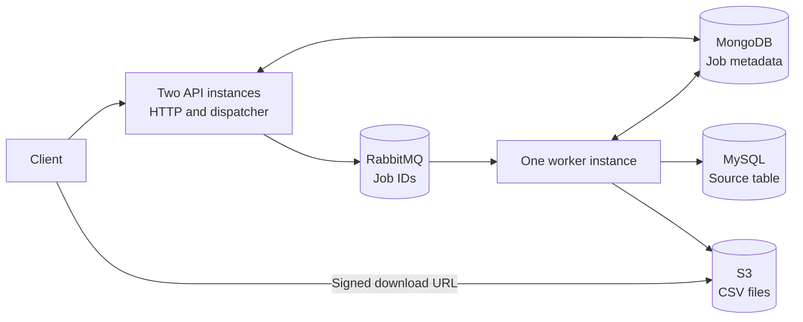
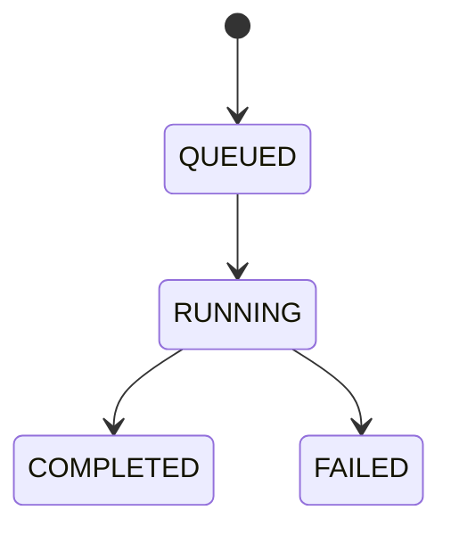

# High-Level Design

## Purpose and constraints

Users request a CSV for a date range over one MySQL table containing approximately **200 million records across two years**. The API accepts concurrent requests quickly; generation runs in the background and users check status before downloading.

The database has about 20% spare capacity at peak and 60% normally. The available resources are MongoDB, RabbitMQ, MySQL, S3 and three to four service instances with one CPU and 2 GB RAM each. The design uses this infrastructure, with no preprocessing or additional hardware.

## Architecture

All service instances run the same Spring Boot application. A startup profile selects the role:

| Role | Responsibility |
| --- | --- |
| `api` | Accept requests, return status/download links and publish pending jobs. |
| `worker` | Consume one job at a time, query MySQL, write CSV and record the result. |
| `local` | Combine both roles in one process for local use. |

The initial layout uses two API copies and one worker. The fourth instance can remain unused. API copies do not open a MySQL reporting pool. Deploying another worker would add another reader; the application has no cluster-wide query permit.

## Request to download

1. The API validates the dates and inserts a `QUEUED` job into MongoDB, including a pending-publication flag. It returns `202 Accepted` with a report ID.
2. A dispatcher claims a pending job and publishes its ID to RabbitMQ. It clears the pending flag only after a routed publication is confirmed.
3. The worker claims the job in MongoDB and changes its status to `RUNNING`.
4. It reads MySQL in ordered pages, writes CSV rows and uploads fixed-size parts to S3. The full result is never held in memory.
5. After the upload completes, it saves the file reference, row count and size in MongoDB, changes the job to `COMPLETED`, then acknowledges the queue message.
6. The client polls status and requests a temporary signed URL. It downloads the file directly from S3.

An export failure records `FAILED`. A crash or lost ownership can cause queue redelivery and a new attempt after the previous claim expires.

## Why these components

| Component | Reason |
| --- | --- |
| MongoDB | Durable job status and atomic claims, separate from the busy source database. |
| RabbitMQ | Waiting work survives application restarts and workers consume at a controlled concurrency. |
| MySQL | The original source of report data, queried through a SELECT-only user. |
| S3 | Large CSV files are stored and downloaded without occupying application memory or API bandwidth. |

Saving the job and pending flag together avoids losing accepted work between MongoDB and RabbitMQ. Publication can still happen more than once, so worker claims and terminal-status checks handle duplicate deliveries.

## Database and memory approach

The source table contains an ID, UTC event time, reference, amount and status. An index on `(occurred_at, id)` supports both date filtering and stable page ordering.

The worker reads **500 rows per query**, then continues after the last timestamp/ID pair. This avoids OFFSET scans over earlier pages. One worker has one consumer, one prefetched job and a MySQL connection pool of one. CSV uploads use an **8-MiB part buffer**. Defaults also bound query duration, total execution time and output size.

Large reports still read every matching row and may delay smaller reports. Completion time depends on the range, queue length, source/database performance and upload speed; the API does not promise a fixed completion time.

## Scope and limits

The current implementation provides asynchronous submission, durable dispatch, worker ownership, bounded reads/uploads, status lookup and signed downloads. Local Compose uses SeaweedFS as an S3-compatible store and includes sample MySQL data.

Source rows are assumed unchanged during an export; pages are not a single transaction-wide snapshot. Crash recovery restarts generation from the beginning. Authentication/ownership, automatic retention, durable resume, delayed worker retries and dead-letter handling are not implemented.

One reader limits concurrency but does not automatically keep reporting within the database's spare 20% or 60%. Full-scale query plans, foreground workload impact and completion times must be measured on the existing deployment before choosing final limits. No adaptive capacity controller is implemented.

See the [LLD](LLD.md) for implementation details and the [README](../README.md) for startup and API commands.
