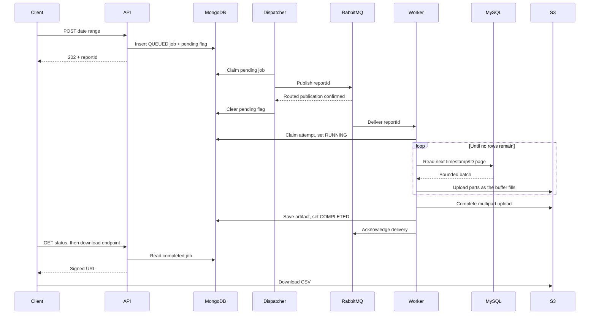

# Low-Level Design

This document describes the current implementation. Read the [HLD](HLD.md) for the architecture and the [README](../README.md) for local commands.

## Code responsibilities

Production code lives under `com.akash.reporting`.

| Package / classes | Responsibility |
| --- | --- |
| `controller.ReportController` | Submit a job, retrieve status and request a download link. |
| `dto` / `model` | HTTP/message contracts and stored job, claim and artifact data. |
| `service.ReportService` | Validate date ranges and insert/read MongoDB jobs. |
| `scheduler.ReportDispatchScheduler` / `service.ReportDispatcher` | Periodically claim pending jobs and arrange publication. |
| `messaging.ReportQueuePublisher` | Publish persistent JSON job IDs and verify broker confirms/returns. |
| `messaging.ReportJobListener` | Validate the message and acknowledge or requeue the processing outcome. |
| `service.ReportWorkerService` / `WorkerLease` | Own an attempt, renew its lease and coordinate export/completion. |
| `repository.ReportJobRepository` | Basic MongoDB job persistence. |
| `repository.ReportDispatchRepository` / `ReportWorkerRepository` | Atomic claims and ownership-checked metadata updates. |
| `repository.ReportEventRepository` | Read one ordered MySQL page. |
| `export.ReportCsvWriter` | Write UTF-8 CSV with escaping and CRLF record endings. |
| `storage.ReportStorage` / `S3ReportStorage` / `S3MultipartUpload` | Upload bounded parts, abort/delete attempt files and sign downloads. |
| `service.ReportDownloadService` | Require a completed job and return a temporary file URL. |
| `config` / `exception` | Validated settings, deployment roles, clients, queue topology and HTTP errors. |

## APIs

| Method | Path | Behavior |
| --- | --- | --- |
| POST | `/api/v1/reports` | Validate and persist a job; return `202`, `reportId`, `statusUrl` and a Location header. |
| GET | `/api/v1/reports/{reportId}` | Return the current job status and result metadata. |
| GET | `/api/v1/reports/{reportId}/download` | Return `downloadUrl`, `expiresAt` and `fileName` for a completed job. |

Request:

```json
{"startDate":"2026-10-01","endDate":"2026-10-02"}
```

Dates are midnight UTC, start inclusive and end exclusive. End must be after start, with a maximum range of 731 days. CSV is the fixed format; unknown request fields are rejected. An unknown report returns `404`; invalid input returns `400`; downloading a non-completed job returns `409`. MongoDB operation failures return `503` with a safe description.

Status responses include `status`, `submittedAt`, `firstStartedAt`, `completedAt`, `attemptCount` and `retryCount`. Completed jobs include `rowCount`, `byteSize` and a relative download endpoint. `retryCount` is attempts minus one, not a configured retry budget. The enum also reserves `RETRYING`; the current processing flow uses `QUEUED`, `RUNNING`, `COMPLETED` and `FAILED`.

## Data model

MongoDB collection: `report_jobs`.

| Fields | Meaning |
| --- | --- |
| `id`, dates, `format`, `status` | UUID job ID, requested UTC bounds and lifecycle state. |
| Submission/start/completion timestamps, `attemptCount` | Job timing and generation attempts. |
| `dispatchPending`, `dispatch` | Pending flag, publication token/lease, next retry time and publication outcome. |
| `worker` | Attempt token and lease expiry. |
| `artifact` | S3 object key, suggested file name, row count and byte size. |
| `failure` | Safe failure code and description. |

Job insertion also stores the pending flag in the same document. MongoDB writes require majority acknowledgement and journaling. Dispatch creates the `pending_report_dispatch` partial index on submission time and ID for pending queued jobs. Dispatchers select the oldest eligible document, although concurrent publication does not guarantee strict end-to-end FIFO ordering.

MySQL table:

```sql
CREATE TABLE report_events (
    id BIGINT NOT NULL PRIMARY KEY,
    occurred_at DATETIME(6) NOT NULL COMMENT 'UTC',
    reference VARCHAR(255) CHARACTER SET utf8mb4 NULL,
    amount DECIMAL(18,2) NULL,
    status VARCHAR(32) NOT NULL,
    INDEX idx_report_events_occurred_id (occurred_at, id)
);
```

The application user has SELECT permission only. The [initialization script](../docker/mysql/01-report-events.sql) includes this schema and sample rows.

## End-to-end sequence



The dispatcher runs inside each API process. The worker renews its MongoDB lease in the background while exporting. For a small or empty CSV, the final part is uploaded when the multipart upload is completed.

## Dispatch and worker ownership

`ReportDispatchScheduler` uses a fixed delay between completed polling cycles. `ReportDispatchRepository.claimNext` atomically selects an eligible pending job, stores a unique claim token and sets a lease. Only that token can record publication or reschedule a failed publish. Competing API copies therefore cannot own the same active dispatch claim.

RabbitMQ uses durable direct exchange `reporting.reports`, durable queue `reporting.reports.jobs` and routing key `report.requested`. A persistent message contains only `{"reportId":"..."}`. Mandatory routing and correlated confirms are enabled. A negative/missing confirm or returned message leaves publication pending for another attempt. A crash between broker acceptance and the MongoDB update can publish a duplicate.

The listener uses manual acknowledgement, concurrency one and prefetch one. `ReportWorkerRepository.claim` accepts a queued job or an expired running attempt. It atomically creates a new token, preserves the first start time and increments the attempt count. Renew/complete/fail operations require a matching token and an unexpired lease. Completed or failed jobs are acknowledged without regenerating them.

## Query and export

The first query reads the requested range:

```sql
SELECT id, occurred_at, reference, amount, status
FROM report_events
WHERE occurred_at >= ? AND occurred_at < ?
ORDER BY occurred_at, id
LIMIT ?;
```

Later pages add this condition, binding the previous page's last timestamp twice and its last ID:

```sql
AND (occurred_at > ? OR (occurred_at = ? AND id > ?))
```

The timestamp/ID index supports the range and order. Including ID prevents skipping records when timestamps are equal. The worker stops after an empty page. A Hikari pool of one, JDBC fetch size and query timeout bound each read. Pages do not share a transaction-wide snapshot, so the design assumes unchanged source rows during generation.

`ReportCsvWriter` writes the fixed header and escapes commas, quotes and newlines. Null fields are empty. The upload holds one fixed-size buffer and sends parts synchronously. Every attempt has a separate object key: `reports/{reportId}/{attemptToken}.csv`. The S3 client sends known-length part bytes with checksum calculation enabled and signed chunk framing disabled for compatibility with the local store.

The worker completes the upload before saving `COMPLETED`. The download service signs a GET request for the saved object; CSV bytes travel directly from storage to the client.

## Defaults and failure handling

| Setting | Default |
| --- | --- |
| Dispatch poll / batch | 1 second / up to 10 jobs per cycle. |
| Dispatch lease / confirm wait / retry delay | 30 / 5 / 5 seconds. |
| Worker batch / reader pool | 500 rows / one connection. |
| Worker lease / heartbeat | 60 / 10 seconds. |
| Worker duration / query timeout | 10 minutes / 30 seconds. |
| Upload buffer / output limit | 8 MiB / 50 GiB. |
| Download URL lifetime | 5 minutes. |

Profiles in `application-api.yaml`, `application-worker.yaml` and `application-local.yaml` select the active components. Shared endpoints and limits live in `application.yaml`. These are configurable defaults, not measured guarantees for a 200-million-row deployment.

| Situation | Current behavior |
| --- | --- |
| Publication fails or its outcome is unknown | Keep the pending job and retry after the configured delay or claim expiry. |
| Source/export failure or execution limit exceeded | Abort incomplete upload, attempt file cleanup and save `FAILED` if still the owner. |
| Lease renewal fails or ownership is lost | Stop at the next check, attempt cleanup and ask for redelivery. |
| Worker crashes | RabbitMQ redelivers; a new attempt can claim after lease expiry and starts from the beginning. |
| MongoDB completion outcome is uncertain | Preserve the uploaded file and requeue so the stored terminal status can be checked. |
| Message is malformed | Reject without requeue; no dead-letter queue is configured. |

Unconfirmed outcomes are requeued after a one-second pause. There is no delayed worker retry budget or durable checkpoint. Cleanup is best effort; a crash can leave orphan objects or incomplete uploads. Deadline checks occur between blocking operations, so stopping can take longer than the nominal execution limit. Authentication, report ownership and automatic retention are also outside the current implementation.
