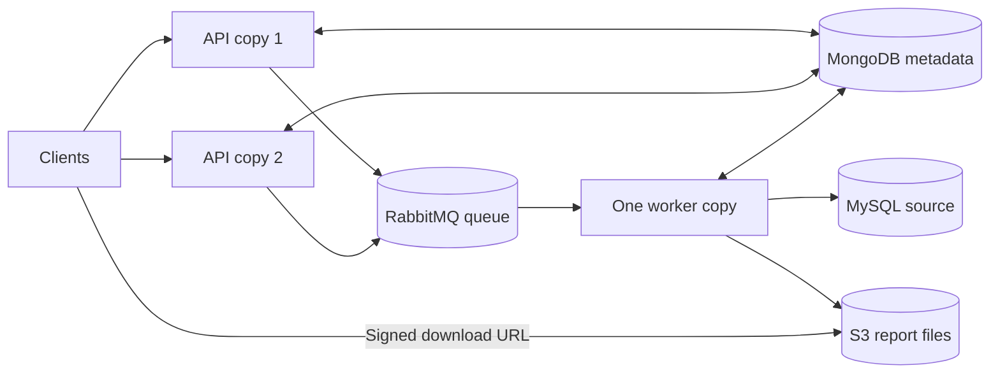

# Deployment roles

The same reporting-service JAR runs in three roles. A Spring profile selects the role at startup. A plain startup defaults to `api`, so adding an API copy does not add a RabbitMQ consumer or MySQL reporting pool.

| Profile | HTTP API | Pending-job dispatcher | Report worker / MySQL reader | Intended use |
| --- | --- | --- | --- | --- |
| `api` (default) | Yes, default port 8081 | Yes | No | Two request-serving instances. |
| `worker` | No HTTP server | No | One consumer, prefetch 1, one MySQL connection | One generation instance. |
| `local` | Yes, default port 8081 | Yes | One consumer and reader | One combined process for local development. |

Choose one role per process. Run one `worker` copy for the proposed deployment. Each additional worker or local process would add a consumer and its own reader connection; these profiles do not provide a distributed concurrency limit. The fourth available instance can remain unused until measured database headroom justifies another role. No new service project or hardware is required.



## Run locally in one terminal

Start dependencies from the project folder, then select `local`:

```sh
cd /Users/akash/GitWorkspace/reporting-service
colima start --runtime docker --vm-type vz --cpu 2 --memory 4 --disk 20
docker context use colima
docker compose up -d --wait mongo rabbitmq mysql storage
./mvnw clean spring-boot:run -Dspring-boot.run.profiles=local
```

The API is at `http://localhost:8081`. Existing Postman collection variables may still use port 8080: set `baseUrl` to `http://localhost:8081`, or set `PORT=8080` on the local command. The [generation guide](report-generation.md) contains the seeded request, signed download steps and GUI addresses.

## Run two API copies and one worker

Build once before starting the processes. This avoids concurrent Maven builds writing into the same target directory:

```sh
./mvnw clean package
```

Stop any combined `local` process, then open three terminals in the project directory.

API copy 1:

```sh
java -jar target/reporting-service-0.0.1-SNAPSHOT.jar \
  --spring.profiles.active=api --server.port=8081
```

API copy 2:

```sh
java -jar target/reporting-service-0.0.1-SNAPSHOT.jar \
  --spring.profiles.active=api --server.port=8082
```

Worker copy:

```sh
java -jar target/reporting-service-0.0.1-SNAPSHOT.jar \
  --spring.profiles.active=worker
```

The worker has no HTTP port and does not publish pending jobs. Both API copies can submit requests, read status and provide download links for the same jobs. They share MongoDB, RabbitMQ and the S3 settings. The worker additionally connects to MySQL. On separate machines, set the existing Mongo/Rabbit/MySQL/S3 connection variables to shared reachable endpoints rather than localhost. The local Compose port bindings and example localhost addresses are for testing on one machine.

An instance means one running JVM process. Three processes on one laptop demonstrate the roles; that does not reproduce the assignment's separate 1-CPU/2-GB instance limits or validate database headroom. Role selection does not tune batch size, report deadlines or output limits.

## Selecting a role

Use either the Spring profile environment variable or a command-line argument:

```sh
SPRING_PROFILES_ACTIVE=worker java -jar target/reporting-service-0.0.1-SNAPSHOT.jar
```

For Maven startup:

```sh
./mvnw spring-boot:run -Dspring-boot.run.profiles=api
```

For an IDE run configuration, select `api`, `worker`, or `local` as the active Spring profile. If the IDE has no profile selected, it runs the default API role and reports remain queued until a worker starts. Spring's startup log shows the active or default profile.

Use the profile to select the role instead of the old `REPORT_WORKER_ENABLED` / `REPORT_DISPATCH_ENABLED` combinations. Profile-specific settings override those placeholders in the base file. Direct overrides of `reporting.worker.enabled`, `reporting.dispatch.enabled`, or `spring.main.web-application-type` can still change a role through Spring's standard configuration precedence; avoid mixing these overrides into normal role deployments. These profiles are deployment presets, not an authorization boundary. Do not combine the role profiles.

The default API port is preserved at 8081. Set `PORT` or `--server.port` for additional API/local copies. Port settings have no effect on the headless worker.

## Verify the roles

1. Start the two APIs without a worker and submit a report. It should be QUEUED in MongoDB and waiting in RabbitMQ.
2. Inspect the queue:

```sh
docker compose exec rabbitmq rabbitmqctl list_queues -p reporting \
  name messages_ready messages_unacknowledged consumers
```

The report queue should show zero consumers while only APIs are running. Other unrelated consumers must not be using this queue.

3. Start one `worker` copy. Consumer count should become one. The queued report should complete and be downloadable through either API copy.
4. Stop the worker with Ctrl+C. The API copies keep accepting requests; those requests wait for generation when the worker returns.

The integration suite automates the two-API/one-worker scenario with isolated queue/database names, verifies API copies create no MySQL pool, and checks that the worker starts without an HTTP server or dispatcher. Existing generation integration tests run the `local` profile to verify the combined development mode.

```sh
./mvnw clean test
./mvnw -Pintegration clean verify
```

The full integration suite requires all four dependencies and the dedicated local MySQL fixture; see the generation guide for test-data side effects.

Stop all application processes with Ctrl+C, then stop dependencies:

```sh
docker compose stop mongo rabbitmq mysql storage
colima stop
```

The named data volumes are retained.
