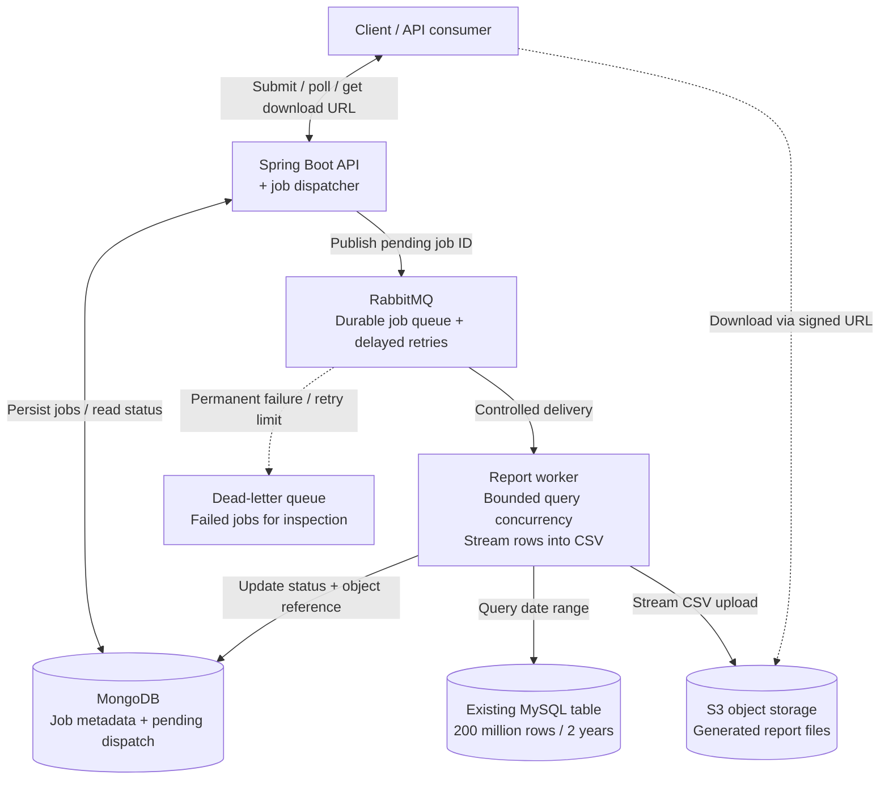

# Reporting service high-level design

The service accepts a date-range report request, returns a job ID, and generates a downloadable CSV in the background. RabbitMQ buffers demand while a bounded worker pool controls the reporting load on the existing MySQL database. MongoDB stores job metadata; S3 stores generated files.

This is a proposed design based on **Reporting Service Assignment.docx**. The assignment facts and design assumptions are separated below; the assignment constraints are reproduced here so this document can be reviewed independently.

## Architecture diagram

The arrows describe requests or writes; MySQL returns rows to the worker, and S3 returns file bytes to the client. The dispatcher is a background component within the API deployment. A submit call returns `202` with a job ID; a download URL is available only after completion. Worker acknowledgements, retries, and dispatch confirmations are described below to keep the diagram focused on the component boundaries.

The editable diagram is also available as [Mermaid source](diagrams/reporting-service.mmd).

## Assignment constraints

| Given in the brief | Design implication |
| --- | --- |
| One MySQL table with 20 crore records across two years | About 200 million rows; queries must use the actual date-range workload and measured query plans. |
| Database has 20% free capacity at peak and 60% normally | Limit reporting work and retain a safety margin; the constrained resource needs clarification. |
| No new hardware | Use the existing database and service instances; this design does not depend on adding a read replica. |
| No preprocessing | Query source rows on demand; do not depend on precomputed summaries or a copied search index. |
| Schema and indexes may be defined | Choose indexes after defining the report fields and filters. |
| Mongo, Rabbit, MySQL, S3, and 3–4 service instances are available | Use each resource for a specific role; each service instance has 1 CPU and 2 GB RAM. |
| Multiple requests with results in “probabilistic time” | Measure queue wait and completion-time distributions; the phrase does not define a latency target. |

## Proposed API contract

| Endpoint | Behavior |
| --- | --- |
| `POST /api/v1/reports` | Validate the date range and authorized filters, persist a job, and return `202 Accepted` with `reportId` and a status URL. |
| `GET /api/v1/reports/{reportId}` | Return `QUEUED`, `RUNNING`, `RETRYING`, `COMPLETED`, or `FAILED`, plus timestamps and any safe error details. |
| `GET /api/v1/reports/{reportId}/download` | Check ownership and completion, then return a short-lived signed download URL. |

Assumptions: asynchronous delivery is acceptable; the initial report exports known columns as CSV; date boundaries use an explicitly documented timezone and an inclusive start with an exclusive end. Fields, filters, retention, and configured request limits remain to be defined. Spring Boot is the proposed application framework, rather than a requirement of the brief.

## How a report moves through the system

1. **Accept durably.** The API validates the request and stores its parameters, initial `QUEUED` state, and a pending-dispatch marker in one MongoDB job document before returning `202`.
2. **Dispatch recoverably.** An API background dispatcher claims pending documents with a lease, publishes each `jobId` to RabbitMQ, and clears the marker after publisher confirmation. The marker lets another dispatcher recover an accepted job if an API instance restarts.
3. **Claim and query.** A worker claims the job using an atomic state transition and a renewable lease. It runs a parameterized, read-only MySQL query for the requested date range, selecting only the report columns.
4. **Stream the output.** The worker reads incrementally through JDBC and uploads CSV using bounded multipart buffers. It does not collect the entire result in memory. S3 upload backpressure must also bound row fetching.
5. **Complete durably.** After the upload succeeds, the worker saves `COMPLETED` and the object reference in MongoDB, then acknowledges the message. The client polls for completion and downloads directly from S3 using the authorized URL.

## Database protection and instance allocation

The [deployment profiles](deployment-roles.md) make these roles explicit using the same JAR: `api` handles HTTP and dispatch, `worker` generates reports without an HTTP server, and `local` combines them for development. A plain startup uses `api`.

Start with **two API instances and one worker instance**, with a single active report query and low message prefetch. API replicas share pending-dispatch work through MongoDB leases. The fourth instance can host another worker only when measurements justify the additional database load and a shared limit caps active queries across all workers. Adding API replicas must not increase the number of MySQL report queries.

Use a small reporting connection pool, query deadlines, admission limits on outstanding jobs, and bounded upload buffers. Validate a date-based index against representative filters and data distributions; an index does not make a report that returns most of the table cheap. Observe queue depth and oldest-job age, active queries, query duration, database CPU and I/O, worker memory, retries, and report completion times.

Treat the capacity percentages as headroom estimates until their meaning is clarified. Begin with a conservative configured concurrency limit, reduce or pause new work during peak load, and tune using measured database impact. A queue controls when work runs; it does not reduce the total work of a broad report. No fixed completion-time promise follows from the brief.

## Failure handling

RabbitMQ delivery is treated as at least once. A crash between publishing and clearing the dispatch marker can publish a duplicate; workers use job state, leases, and an attempt token to prevent duplicate completion. Completed jobs are acknowledged without regeneration, and stale running jobs are recovered after lease expiry. Only the current attempt may commit the final object reference.

Transient failures use bounded delayed retries. A worker acknowledges the original message only after completion, or after the retry or terminal-failure outcome is durably recorded and the replacement message is confirmed. Exhausted and permanent failures become `FAILED` and are routed to a dead-letter queue for inspection. Incomplete uploads and abandoned attempt objects are cleaned up. Report files have a defined retention policy, with expired downloads reported clearly.

These mechanisms require precise state transitions and timeout choices in the low-level design, including aligning broker acknowledgement timeouts with the maximum job duration.

## Decisions to settle before implementation

- Define the report schema, allowed filters, typical and maximum date ranges, and expected concurrent requests.
- Agree on queue-wait and completion-time targets, including behavior when the backlog or execution deadline is exceeded.
- Clarify what “free” database capacity measures and how the service learns about peak periods.
- Decide whether reports must represent a consistent snapshot and whether historical rows can change during generation.
- Define authentication, job ownership, output limits, and report retention.

For local development, configure an S3-compatible endpoint or S3 emulator, such as MinIO or LocalStack, through the same storage abstraction. The diagram's S3 component represents the storage role; an AWS account is not required for the initial local implementation.
