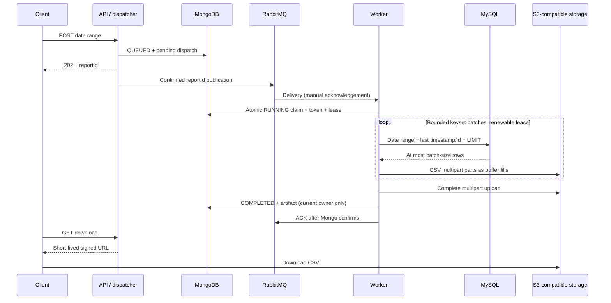

# Milestone 3: generate and download a report

Milestone 3 completes the first export: submit a date range, dispatch its ID, claim it in a worker, read MySQL in bounded batches, upload a UTF-8 CSV, save completion in MongoDB, and return a signed download URL. Git changes are left for review.

## Local startup

Prerequisites remain Java 21, Docker CLI/Compose and Colima. MySQL and the S3-compatible store run in containers; no local MySQL installation or AWS account is needed. Stop any older application process before restarting.

```sh
colima start --runtime docker --vm-type vz --cpu 2 --memory 4 --disk 20
docker context use colima
cd /Users/akash/GitWorkspace/reporting-service
docker compose pull
docker compose up -d --wait mongo rabbitmq mysql storage
docker compose ps
REPORT_WORKER_ENABLED=true ./mvnw clean spring-boot:run
```

The first MySQL start creates `reporting_source.report_events`, eight fixture rows and a SELECT-only `report_reader` account. Initialization runs only for a fresh MySQL volume. Existing MongoDB and RabbitMQ volumes are retained. The object store creates the private `reporting-exports` bucket. The image versions are pinned in Compose.

SeaweedFS supplies local S3 storage. MinIO's previously published images were unavailable when this milestone was implemented. The Java storage implementation uses the AWS S3 SDK and an endpoint override, so it can also target a provisioned S3 bucket. Local credentials below are development defaults.

The API binds to `127.0.0.1:8080`; every published container port binds to loopback. Worker processing defaults to disabled. Use the command above for one combined API/dispatcher/worker locally. Additional API processes must leave `REPORT_WORKER_ENABLED` unset. This milestone supports one enabled worker deployment; it does not enforce a cluster-wide MySQL concurrency permit.

## Test the full flow

1. Submit the seeded day. The start is inclusive and end exclusive, both UTC.

```sh
curl -i -X POST http://localhost:8080/api/v1/reports \
  -H 'Content-Type: application/json' \
  -d '{"startDate":"2026-10-01","endDate":"2026-10-02"}'
```

2. Copy `reportId` from the response. Poll until `COMPLETED` (the small fixture may finish before the first GET).

```sh
REPORT_ID='paste-the-reportId-here'
curl -sS "http://localhost:8080/api/v1/reports/$REPORT_ID"
```

Expected: `rowCount: 5`, `attemptCount: 1`, start/completion timestamps, `byteSize`, and a relative `downloadUrl`. The CSV contains IDs 2–6 in order, including two equal timestamps, quotes, a comma, an embedded newline and Unicode. IDs 1 and 7 are outside this date range. A date range such as October 10–11 returns a header-only CSV and row count zero.

3. Request a signed URL, then download it. The API response is JSON; it does not redirect automatically.

```sh
curl -sS "http://localhost:8080/api/v1/reports/$REPORT_ID/download"
```

Copy the complete `downloadUrl` from that JSON response:

```sh
curl --fail --output report.csv 'paste-the-complete-downloadUrl-here'
```

Keep the URL quoted because it contains `&`. The link lasts five minutes and can be opened directly in a browser. Ask the endpoint for a new link after expiry. Unknown report IDs return 404; queued/running/failed jobs return 409 from the download endpoint. A malformed UUID returns 400. Successful status and download responses use `Cache-Control: no-store`.

The application still has no authentication or job ownership checks. Use this local development setup until those are implemented; the signed URL grants access to whoever holds it.

## Inspect local services

| Service | Address / command | Local credentials |
| --- | --- | --- |
| RabbitMQ GUI | http://localhost:15672 → Queues and Streams → `reporting.reports.jobs` | `reporting` / `reporting-local`, vhost `reporting` |
| MongoDB Compass | `mongodb://127.0.0.1:27017` → `reporting.report_jobs` | No local authentication |
| Stored files | http://localhost:8888/buckets/reporting-exports/ | Local filer view; published only on loopback |
| S3 endpoint | http://localhost:8333 | `reporting` / `reporting-local-storage` |
| MySQL | `127.0.0.1:3306`, schema `reporting_source` | `report_reader` / `report-reader-local` |

The local filer view is for inspection and has no login. S3 requests use configured credentials; unsigned S3 downloads are denied. RabbitMQ should show one consumer with the worker enabled, and messages drain after processing. Tiny reports may pass through RUNNING too quickly to observe manually.

```sh
docker compose exec mysql mysql -ureport_reader -preport-reader-local reporting_source \
  -e 'SELECT * FROM report_events ORDER BY occurred_at, id;'
docker compose exec mongo mongosh reporting --quiet \
  --eval 'db.report_jobs.find({}, {status:1, attemptCount:1, artifact:1, failure:1, worker:1}).pretty()'
docker compose exec rabbitmq rabbitmqctl list_queues -p reporting \
  name messages_ready messages_unacknowledged consumers
```

For a separate worker process after starting the API normally:

```sh
PORT=8081 REPORT_WORKER_ENABLED=true REPORT_DISPATCH_ENABLED=false ./mvnw spring-boot:run
```

Run exactly one enabled worker. A worker-only process still exposes the API on its chosen port for this milestone.

## Implementation and limits



| Package / class | Responsibility |
| --- | --- |
| `messaging.ReportJobListener` | Validate the small queue envelope; ACK confirmed terminal outcomes; requeue uncertain outcomes. |
| `service.ReportWorkerService` | Claim, read, write, complete/fail, and clean up its own attempt. |
| `service.WorkerLease` | Renew ownership independently of query/upload work; stop on lost ownership or deadline. |
| `repository.ReportWorkerRepository` | Atomic claim/reclaim, lease renewal, token- and lease-guarded terminal updates. |
| `repository.ReportEventRepository` | Parameterized MySQL date-range queries with keyset pagination. |
| `export.ReportCsvWriter` | UTF-8, CRLF records, escaped commas/quotes/newlines, ISO UTC timestamps, decimal amounts. Null fields are empty. |
| `storage.ReportStorage` | Storage boundary used by generation and downloading. |
| `storage.S3ReportStorage`, `S3MultipartUpload` | Signed URLs, synchronous bounded multipart uploads, abort and deletion. |
| `service.ReportDownloadService`, `controller.ReportController` | Completed-job check and JSON download response. |
| `config.WorkerConfiguration`, `StorageConfiguration` | Separate worker activation, one-connection reader pool, manual-ack consumer, S3 clients. |

The report source is the provisional `report_events` schema in `dev/mysql/01-report-events.sql`. `occurred_at` is `DATETIME(6)` representing UTC, and `(occurred_at, id)` is indexed. Queries select fixed columns, sort by that pair and continue strictly after the previous pair. Each query returns at most 500 rows by default; JDBC cursor fetching is also enabled. The connection is released between batches. The MySQL account has SELECT permission only. The source schema and query plan still need validation against the real database.

Each worker holds at most one query connection and consumes one delivery at a time. Application memory is bounded by one row batch, a 64 KiB CSV writer buffer, an 8 MiB upload buffer and up to 10000 small part descriptors, plus driver/SDK overhead. Synchronous upload backpressure prevents unbounded fetching. The file is never collected into a single byte array, result list or temporary CSV file. Default output limit is 50 GiB; part count is capped at 10000. Limits fail the job rather than truncating the report.

A 60-second worker lease is renewed every 10 seconds on a separate thread. Only the matching token with an unexpired lease may renew or finish. Attempt-specific object keys prevent an old worker from overwriting a newer attempt's file. A completed/failed duplicate is acknowledged without regeneration. An active-lease duplicate is requeued at a bounded rate; a redelivered RUNNING job can restart from the beginning after lease expiry. `attemptCount` tracks worker claims; dispatch attempts remain separate.

The first start timestamp is preserved on reclaim. Completed metadata includes the object key and filename internally, row count and byte size; public status omits storage keys, credentials and worker tokens. A report can start before the dispatcher clears its pending marker, so claiming does not require `dispatchPending=false`.

Source/storage/output-limit/deadline failures abort the multipart upload, attempt cleanup and persist a safe `FAILED` outcome before acknowledging. Mongo failures during claim/finalization leave the delivery recoverable. If the completion update times out, its outcome may be uncertain, so the completed object is preserved for redelivery rather than deleted. Cleanup is best effort; ambiguous completion and process crashes can leave abandoned objects or multipart uploads. Lifecycle cleanup and reconciliation are later work. Invalid queue envelopes are rejected and logged; no DLQ is configured yet.

Default execution deadline is ten minutes (configurable up to fifteen), JDBC query timeout is 30 seconds, and S3 calls have 30-second attempt / 45-second overall timeouts. Deadline checks occur between blocking operations, so termination can exceed the deadline by a bounded I/O operation. Keep the broker's delivery acknowledgement timeout above the maximum execution time plus I/O/metadata margin. The local RabbitMQ default is sufficient for this bounded milestone.

Rows are assumed immutable for the export duration. Keyset pagination is not a transaction-wide snapshot: inserts, deletes or updates during an export can affect its contents. There is no durable cursor, mid-file resume, delayed retry budget, DLQ, fair scheduling, global query permit, file splitting, authentication, ownership or retention implementation yet. These remain later milestones. A failed source/storage export is terminal in milestone 3; submit a new request after fixing the cause.

## Configuration

| Environment variable | Default | Purpose |
| --- | --- | --- |
| `REPORT_WORKER_ENABLED` | `false` | Enable one local worker explicitly. |
| `REPORT_WORKER_BATCH_SIZE` | `500` | Rows per query, 1–5000. |
| `REPORT_WORKER_MAX_DURATION` | `10m` | Execution deadline, at most 15m. |
| `REPORT_MYSQL_URL` | `jdbc:mysql://localhost:3306/reporting_source` | Reader database. |
| `REPORT_MYSQL_USERNAME` / `REPORT_MYSQL_PASSWORD` | `report_reader` / `report-reader-local` | SELECT-only local account. |
| `REPORT_S3_ENDPOINT` | `http://localhost:8333` | Endpoint used both for uploads and signed URLs; must be reachable by the application and downloader. |
| `REPORT_S3_REGION` / `REPORT_S3_BUCKET` | `us-east-1` / `reporting-exports` | Provisioned destination. |
| `REPORT_S3_ACCESS_KEY` / `REPORT_S3_SECRET_KEY` | `reporting` / `reporting-local-storage` | Local S3 credentials. |
| `REPORT_S3_PATH_STYLE` | `true` | Local endpoint addressing. |
| `REPORT_MAX_OUTPUT_BYTES` | `53687091200` | Maximum generated CSV size. |

Other validated settings live under `reporting.worker` and `reporting.storage` in `application.yaml`. For AWS S3, provision the bucket and scoped credentials, remove the endpoint override with `--reporting.storage.endpoint=` and set the region/addressing appropriately. Automatic AWS credential discovery and production secret management are outside this local milestone.

## Verification and shutdown

With all four dependencies running:

```sh
./mvnw clean test
./mvnw -Pintegration clean verify
```

Integration tests use fresh Mongo databases and queue names. The worker integration test uses the dedicated local `reporting_source` fixture, writes temporary large-report rows with the local root account, and temporarily renames the fixture table to exercise failure handling; do not run it against a shared/production source. It cleans up its test objects and temporary rows. Optional test endpoint variables are `MONGODB_TEST_ADDRESS`, `RABBITMQ_TEST_HOST`, `RABBITMQ_TEST_PORT`, `MYSQL_TEST_PORT` and `S3_TEST_PORT`.

```sh
# After Ctrl+C in each application terminal:
docker compose stop mongo rabbitmq mysql storage
colima stop
```

Stopping retains named volumes, including source rows and generated files. Do not use `docker compose down -v` when you want to retain local data.

## Postman

Import `/Users/akash/GitWorkspace/postman/Reporting Service - Milestone 3.postman_collection.json`. It is kept outside this repository. Set Collection Runner delay to 500 ms; the two polling requests repeat until completion, up to 60 polls. When sending manually, resend the status request until COMPLETED before requesting a download URL. This separate collection leaves your existing milestone 1/2 collections untouched.
